<!--
  NOTA: "sentinel-soc" y "retail-pulse" son proyectos placeholder (coming soon).
  Renómbralos y agrega los links reales cuando crees los repositorios.
  Los banners, el terminal y los títulos de sección son SVG locales en /assets
  (no dependen de servicios externos, por eso ya no se quedan cargando).
-->

<div align="center">



<br/>

<a href="https://github.com/OAlexProgramerO"></a>


<br/><br/>



<p align="center">
  🚀 Construyo <b>soluciones tecnológicas de punta a punta</b>: desde la recolección y análisis de datos hasta el despliegue de aplicaciones robustas.<br/>
  🔐 Apasionado por la <b>ciberseguridad</b>, los <b>datos</b> y la <b>inteligencia artificial</b>.<br/>
  🧠 Convierto datos en decisiones, código en productos y problemas en oportunidades.
</p>



<br/><br/>



<table>
  <tr>
    <td align="center" width="25%" valign="top">
      <h3>📊<br/>Data &amp; Analytics</h3>
      <sub>Pipelines, análisis y dashboards que convierten datos crudos en decisiones.</sub>
    </td>
    <td align="center" width="25%" valign="top">
      <h3>💻<br/>Software Development</h3>
      <sub>Servicios backend, APIs y apps web construidas de punta a punta.</sub>
    </td>
    <td align="center" width="25%" valign="top">
      <h3>🛡️<br/>Cybersecurity</h3>
      <sub>Mentalidad security-first: hardening, monitoreo y conciencia de amenazas.</sub>
    </td>
    <td align="center" width="25%" valign="top">
      <h3>🤖<br/>Machine Learning</h3>
      <sub>Modelos predictivos, evaluación y servicios de inferencia.</sub>
    </td>
  </tr>
</table>

<br/>



<table>
  <tr>
    <td align="center" width="33%" valign="top">
      <br/><br/>
      
    </td>
    <td align="center" width="33%" valign="top">
      <br/><br/>
      
    </td>
    <td align="center" width="33%" valign="top">
      <br/><br/>
      
    </td>
  </tr>
  <tr>
    <td align="center" width="33%" valign="top">
      <br/><br/>
      
    </td>
    <td align="center" width="33%" valign="top">
      <br/><br/>
      
    </td>
    <td align="center" width="33%" valign="top">
      <br/><br/>
      <br/>
      
      
      
    </td>
  </tr>
</table>

<br/>



<table>
  <tr>
    <td align="center" width="50%" valign="top">
      <h3><a href="https://github.com/OAlexProgramerO/wifi-tunja-smart-predictor">📡 wifi-tunja-smart-predictor</a></h3>
      
      
      <br/><br/>
      <sub>Sistema de machine learning de punta a punta para predecir la demanda de conexiones WiFi públicas en Tunja, Colombia: pipelines de datos, evaluación de modelos, servicios de inferencia con FastAPI y dashboard en Streamlit.</sub>
      <br/><br/>
      
      
      
      
      <br/><br/>
      <a href="https://github.com/OAlexProgramerO/wifi-tunja-smart-predictor"></a>
    </td>
    <td align="center" width="50%" valign="top">
      <h3><a href="https://github.com/OAlexProgramerO/pqrs-flow">📨 pqrs-flow</a></h3>
      
      
      <br/><br/>
      <sub>Sistema web para radicar, rastrear y gestionar PQRS (Peticiones, Quejas, Reclamos y Sugerencias) con JavaScript, Node.js y Express. Incluye IDs únicos por caso, seguimiento de estado y panel de administración.</sub>
      <br/><br/>
      
      
      
      
      <br/><br/>
      <a href="https://github.com/OAlexProgramerO/pqrs-flow"></a>
    </td>
  </tr>
  <tr>
    <td align="center" width="50%" valign="top">
      <h3>🛰️ sentinel-soc</h3>
      
      <br/><br/>
      <sub>Plataforma de monitoreo de seguridad que ingiere logs, detecta actividad sospechosa y genera alertas en tiempo real mediante una API REST y un dashboard para analistas.</sub>
      <br/><br/>
      
      
      
      
      
      
      <br/><br/>
      
    </td>
    <td align="center" width="50%" valign="top">
      <h3>📈 retail-pulse</h3>
      
      <br/><br/>
      <sub>Plataforma full-stack de inventario y analítica de ventas con control de acceso por roles, API REST y dashboards interactivos de reportes.</sub>
      <br/><br/>
      
      
      
      
      
      
      <br/><br/>
      
    </td>
  </tr>
</table>

<br/>




<!--
  OPCIONAL — serpiente de contribuciones (se genera sola con GitHub Actions):
  1) Sube .github/workflows/snake.yml y ejecuta el workflow una vez (Actions > Generate Snake > Run workflow).
  2) Cuando exista la rama "output", descomenta esto:

<br/><br/>

-->

<br/><br/>



<a href="https://github.com/OAlexProgramerO"></a>


<br/><br/>

```bash
alex@github:~$ echo "Code is poetry. Security is the rhyme."
Code is poetry. Security is the rhyme.
alex@github:~$ exit   # thanks for stopping by 💜
```

</div>
